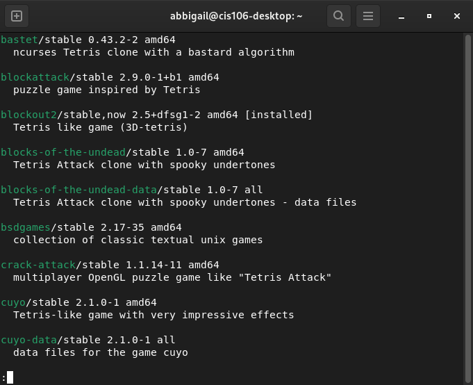
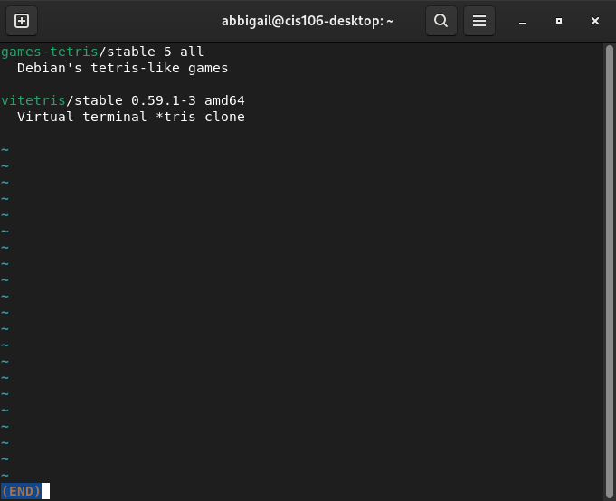
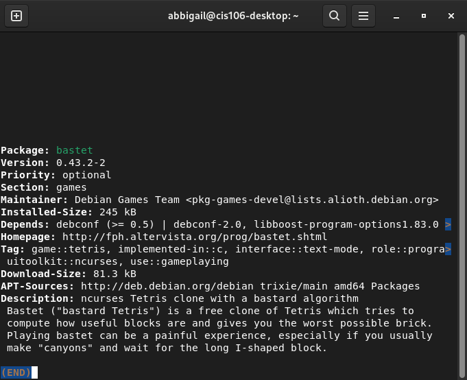
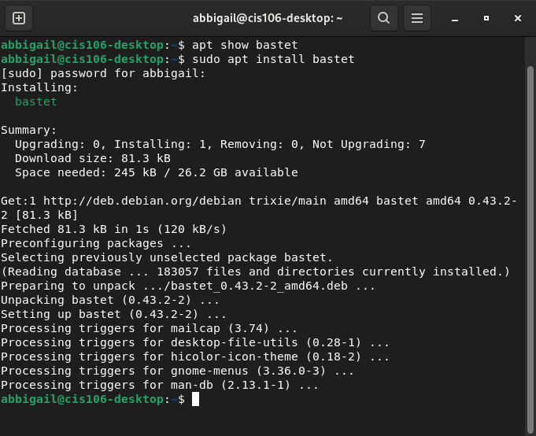
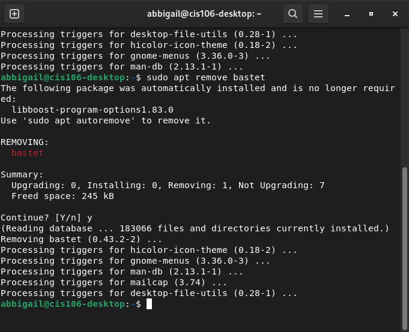
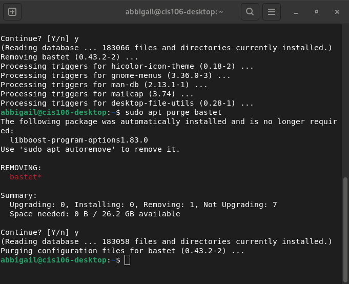
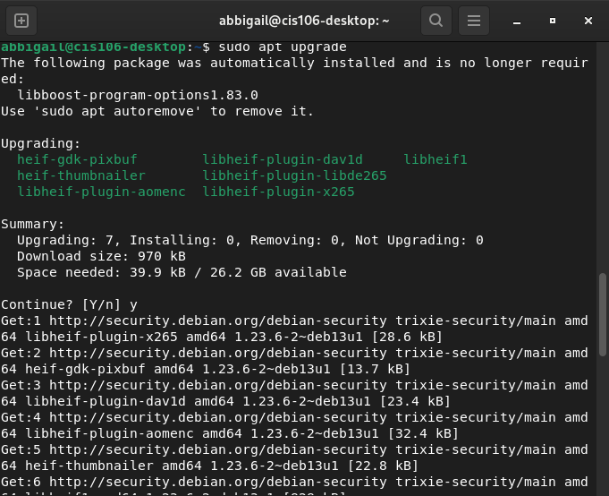
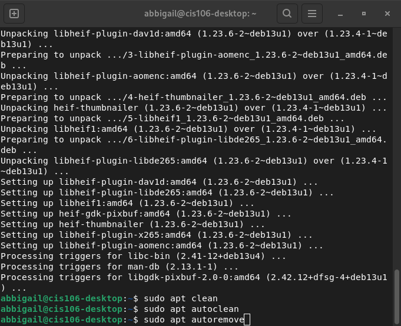
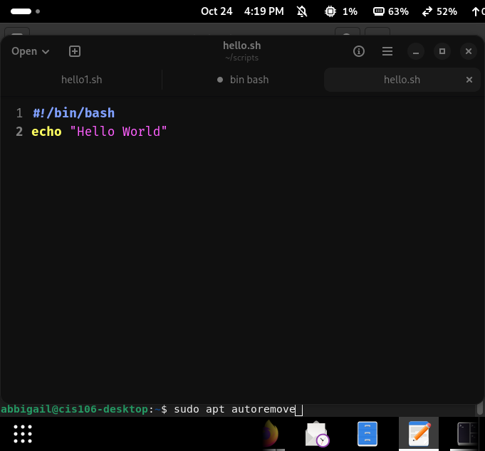
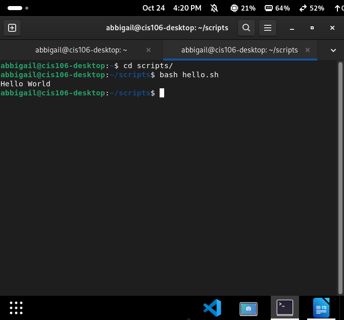

# Notes 4 APT and Shell Scripting

# 1. Installing and Removing Software with APT

**What is APT?**

APT stands for Advanced Package Tool. It is a set of tools for managing Debian packages. APT can  do installation resuming and also search for packages using a local cache of the available packages, APT is also used to update all the packages in the system. 

Most software installation and removal commands require sudo because they make changes to the system. The command may ask for the user's password before continuing.

## 1.1 Searching for Packages

Before installing software, I can use apt search to find packages in the available repositories.

**Example** - apt search "tetris"

This searches package names and descriptions for the word tetris.
To search only package names, use the --names-only option.

**Example** - apt search --names-only "tetris"

This is useful when I want to find packages by their names instead of matching words in their descriptions.

Screenshot: 

## 1.2 Viewing Package Information

The apt show command displays information about a package, including its description, version, dependencies, and installation size.

**Example** - apt show bastet

I can use this information to check what a package does before installing it.

Screenshot: 

## 1.3 Installing Software

The apt install command installs software from the configured package repositories.

**For example**, to install the bastet package:

sudo apt install bastet

To install more than one package in the same command:

sudo apt install bastet firefox

APT displays the packages and dependencies it plans to install. I should review the changes and confirm when prompted. The -y option automatically answers yes to confirmation prompts, so I should use it carefully.

sudo apt install bastet -y

Screenshot: 

.

## 1.4 Removing Software

The apt remove command uninstalls a package but keeps its system-wide configuration files.

**Example** -sudo apt remove bastet

This is useful when you no longer need a program but might want to keep its configuration.

## 1.5 Purging Software

The apt purge command removes a package and its system-wide configuration files.

**Example** -sudo apt purge bastet

The main difference is that remove keeps system-wide configuration files, while purge removes them. Neither command deletes configuration files stored in a user's home directory.

Screenshot: 

## 1.6 Updating Package Information and Upgrading Software

The apt update command refreshes the local package lists. It does not, by itself, upgrade installed software.

**Example **- sudo apt update

The apt upgrade command installs available upgrades for installed packages.

**Example** -sudo apt upgrade

* Update the package lists before checking for and installing available upgrades.

## 1.7 Cleaning Up APT

APT can remove downloaded package files and unnecessary dependencies to help free up space.

**Example:**
- sudo apt clean
- sudo apt autoclean
- sudo apt autoremove

* apt clean removes downloaded package files from the local cache.
* apt autoclean removes cached package files that can no longer be downloaded.
* apt autoremove removes automatically installed dependencies that are no longer needed.

# 2. Creating and Running a Shell Script

**What Is a Shell Script?**

A shell script is a text file that contains Linux commands. Instead of typing every command separately into the terminal,you can put multiple commands into one file and run them together.

Bash is a common Linux shell. A Bash script usually has the **.sh** file extension and starts with a shebang line that tells Linux which interpreter to use.

## 2.1 Creating a Shell Script in a Text Editor

First, open a text editor application, such as GNOME Text Editor.

1. Type the shebang at the top of the file. This tells Linux to use Bash to run the script.

**Example** -#!/bin/bash

2. Open the file manager and make sure you have a folder where you can save your script. For example, you can create a folder named `scripts` in your home directory.

3. Return to the text editor and write your shell commands below the shebang.

4. Press `Ctrl + S` to save the file.

5. When prompted, choose your scripts folder and give the file a name ending in `.sh`, such as `hello.sh`.

**Example of a basic shell script:**
#!/bin/bash

echo "Hello World"

The `#!/bin/bash` line identifies the Bash interpreter, and `echo` prints the message to the terminal.

**Screenshot:** 

## 2.2 Running a Script with Bash

In the terminal, navigate to the directory containing the script and run it with the bash command.

cd scripts/
bash hello.sh

The output should be:
Hello World

Using bash hello.sh runs the script through Bash without requiring to make the file executable first.

Screenshot:

 