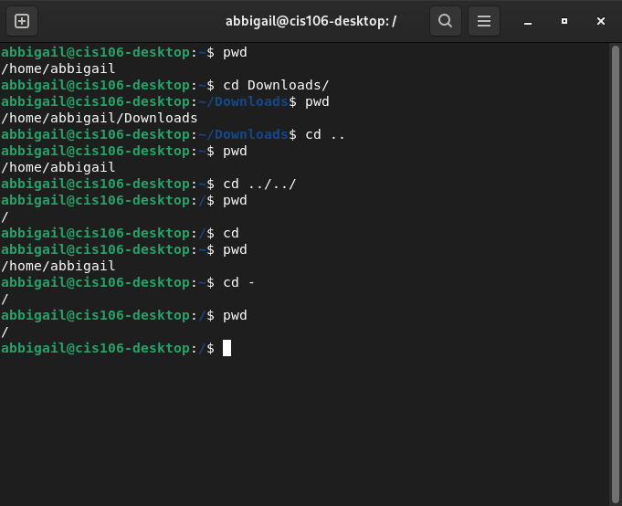
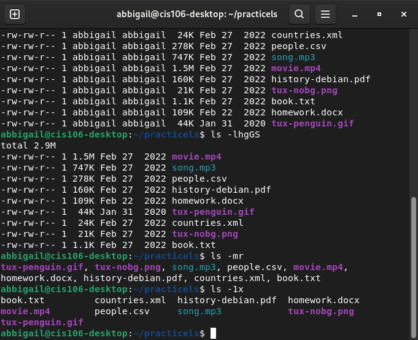
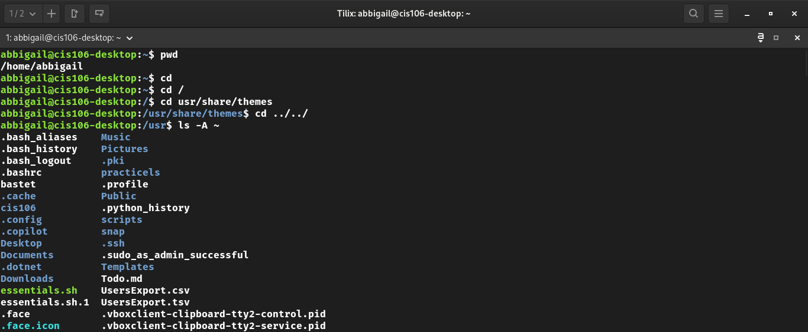
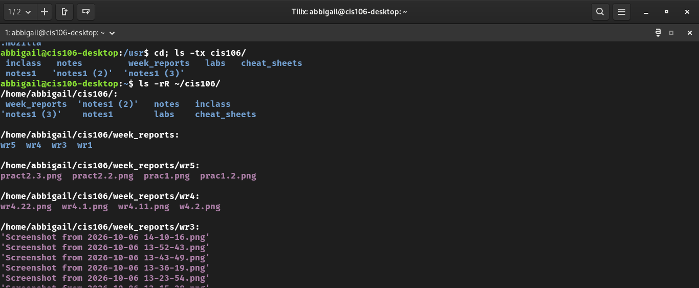
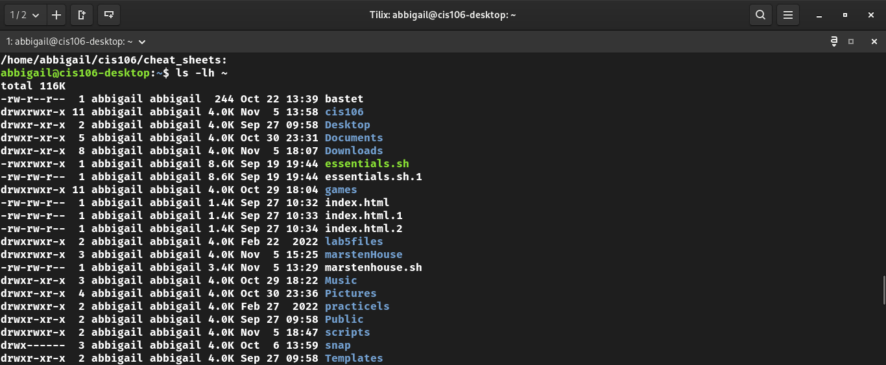
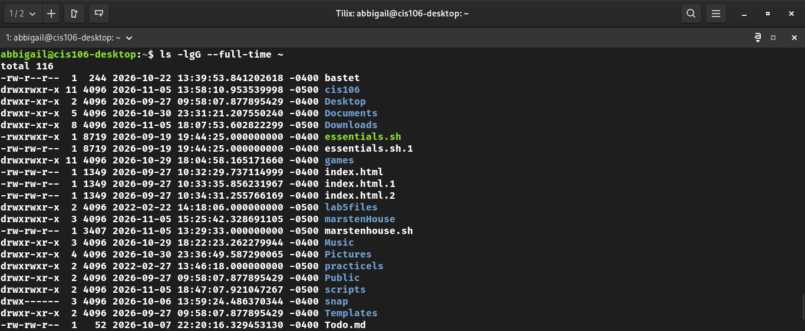
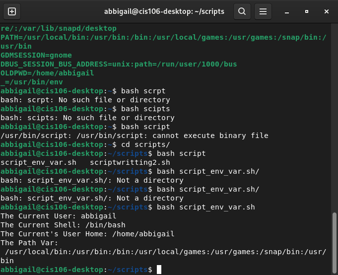
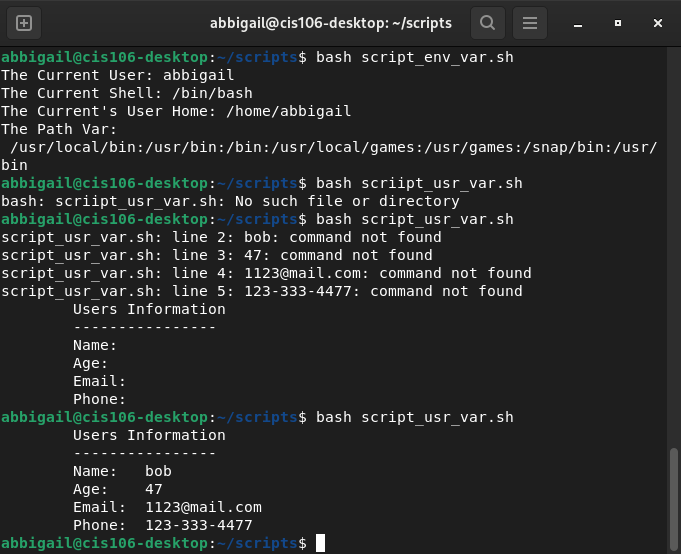

# Week Report 5

## Completed Work for Week 5

## Practice Screenshots

### Practice 1: The Linux Filesystem

### Practice 2: The Linux Filesystem

### Practice 3: The Linux Filesystem

### Practice 2: Shell Scripting Chapter 2

### Practice 3: Shell Scripting Chapter 2

* Link to lab5
[lab5](https://github.com/Abbigailpowell/cis106/blob/main/labs/lab5/lab5.md)

* Link to notes4
[notes5](https://github.com/Abbigailpowell/cis106/blob/main/notes/notes5/notes5.md)